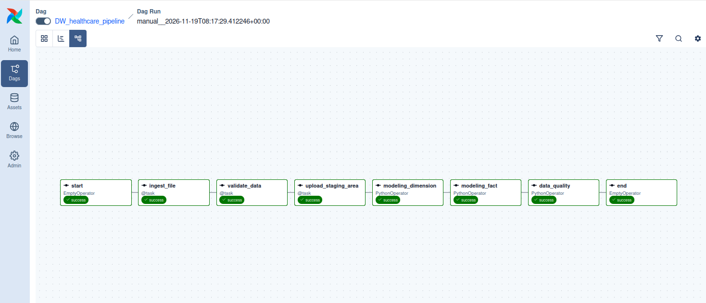

# DW_healthcare_pipeline
A data warehouse ETL pipeline project featuring data modeling, Apache Airflow 3 orchestration, and PostgreSQL data storage.

# Source 
[Health Record Dataset in Sri Lanka](https://www.kaggle.com/datasets/dewminimnaadi/health-record-dataset-in-sri-lanka#columns--schema) on kaggle.

# Workflow
The pipeline is composed of six tasks that execute sequentially from start to finish.

# Data modeling design
Designed and implemented a star schema data model with dimension and fact tables.

