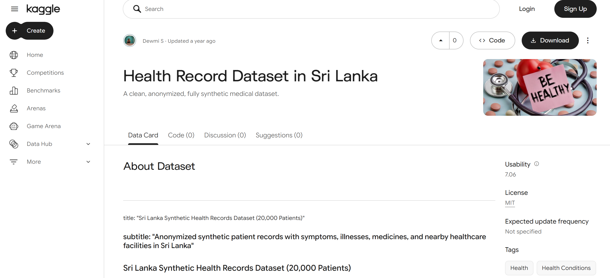
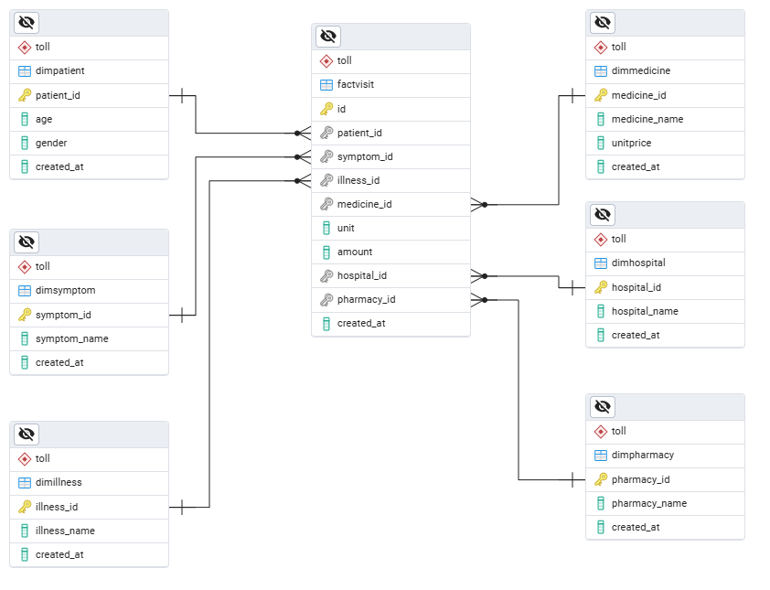

# DW_healthcare_pipeline
A data warehouse ETL pipeline project featuring data modeling, Apache Airflow 3 orchestration, and PostgreSQL data storage.

# Source 
Health Record Dataset in Sri Lanka on kaggle.

# workflow

# data modeling design
Designed and implemented a star schema data model with dimension and fact tables.

